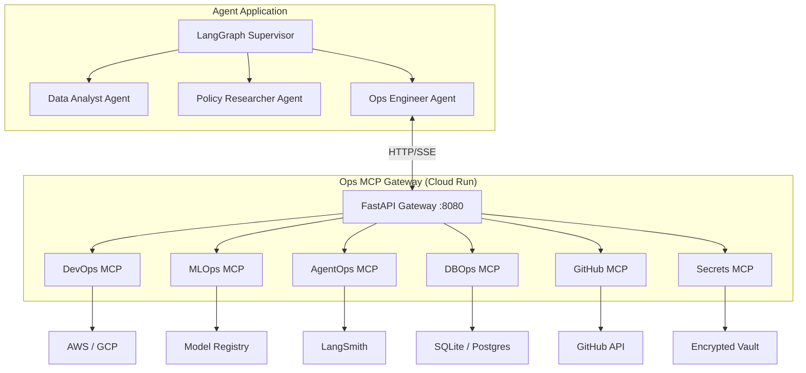

# 🛠️ Ops MCP Suite — Production Agent Platform Engineering Toolkit

A production-grade collection of **6 MCP (Model Context Protocol) servers** that provide operational tooling for AI agent platforms. Designed as a micro-MCP architecture where each server is independently deployable but served through a unified FastAPI gateway.

## Architecture



## MCP Servers

### 1. 🔧 DevOps MCP (`devops_mcp.py`)
Cloud infrastructure and credential management.

| Tool | Description | Real/Simulated |
|------|-------------|----------------|
| `provision_s3_bucket` | Create AWS S3 bucket with versioning & tagging | Real (boto3) / Simulated |
| `generate_bedrock_credentials` | Assume IAM role for Bedrock access | Real (STS) / Simulated |
| `manage_secrets` | CRUD operations on local JSON secret store | Real |
| `create_iam_policy` | Generate least-privilege IAM policy JSON | Real |
| `deploy_docker_container` | Simulate docker build→push→deploy workflow | Simulated |
| `check_service_health` | HTTP health check with latency measurement | Real |

### 2. 🧠 MLOps MCP (`mlops_mcp.py`)
Model lifecycle and vector database management.

| Tool | Description | Real/Simulated |
|------|-------------|----------------|
| `provision_vector_db` | Provision Pinecone-style vector index | Simulated |
| `trigger_fine_tuning` | Start a fine-tuning job with hyperparams | Simulated |
| `list_model_registry` | List registered models with versions & metrics | Simulated |
| `promote_model` | Promote model between stages | Simulated |
| `fetch_model_metrics` | Latency, throughput, cost, error rate | Simulated |
| `compare_models` | Side-by-side model comparison | Simulated |

### 3. 📊 AgentOps MCP (`agentops_mcp.py`)
Observability, tracing, and prompt engineering.

| Tool | Description | Real/Simulated |
|------|-------------|----------------|
| `create_langsmith_project` | Create tracing project, return env vars | Simulated |
| `run_eval_harness` | Trigger LLM-as-judge evaluation | Simulated |
| `log_agent_trace` | Log structured trace to JSONL file | Real |
| `get_trace_summary` | Aggregate stats from trace logs | Real |
| `create_prompt_template` | Register versioned prompt template | Real |
| `list_prompt_versions` | List all versions of a template | Real |

### 4. 🗄️ DBOps MCP (`dbops_mcp.py`)
Database provisioning, schema inspection, and querying.

| Tool | Description | Real/Simulated |
|------|-------------|----------------|
| `provision_database` | Create SQLite DB (or simulated Postgres) | Real / Simulated |
| `apply_migrations` | Run Alembic-style migrations | Simulated |
| `run_query` | Execute read-only SQL queries | Real |
| `list_tables` | List tables and column schemas | Real |
| `clone_database` | Clone a SQLite DB for staging | Real |
| `create_read_only_user` | Generate read-only user SQL | Simulated |
| `get_db_stats` | Row counts, file size, index stats | Real |

### 5. 🐙 GitHub MCP (`github_mcp.py`)
Repository management, PRs, issues, and code search.

| Tool | Description | Real/Simulated |
|------|-------------|----------------|
| `list_repos` | List repos for user or org | Real (API) / Simulated |
| `get_repo_info` | Detailed repo metadata | Real (API) / Simulated |
| `list_pull_requests` | List PRs with review status | Real (API) / Simulated |
| `create_issue` | Create GitHub issue with labels | Real (API) / Simulated |
| `search_code` | Search code across repos | Real (API) / Simulated |
| `get_file_contents` | Read file from repo | Real (API) / Simulated |

### 6. 🔐 Secrets MCP (`secrets_mcp.py`)
Encrypted credential management with Fernet encryption.

| Tool | Description | Real/Simulated |
|------|-------------|----------------|
| `store_secret` | Encrypt and store a secret | Real |
| `get_secret` | Decrypt and retrieve a secret | Real |
| `list_secrets` | List keys with masked values | Real |
| `delete_secret` | Remove a secret | Real |
| `rotate_secret` | Generate new value, keep old version | Real |
| `generate_api_key` | Generate cryptographically secure API key | Real |

---

## Quick Start

### Local Development (stdio)

Each server can run standalone for local development:

```bash
# Run a single MCP server
python devops_mcp.py

# Test via MCP client
python test_all_servers.py
```

### Gateway Mode (HTTP)

Run all servers through the unified gateway:

```bash
pip install -r requirements.txt
python gateway.py
# Gateway available at http://localhost:8080
```

**Endpoints:**
- `GET /` — Service info and server list
- `GET /health` — Health check
- `GET /servers` — All servers with their tools
- `GET /{server}/tools` — List tools for a server
- `POST /{server}/call/{tool}` — Call a tool with JSON body

### Docker

```bash
docker build -t ops-mcp-gateway .
docker run -p 8080:8080 ops-mcp-gateway
```

### Cloud Run Deployment

```bash
gcloud builds submit --tag us-central1-docker.pkg.dev/PROJECT/REPO/ops-mcp-gateway:latest
gcloud run deploy ops-mcp-gateway \
  --image us-central1-docker.pkg.dev/PROJECT/REPO/ops-mcp-gateway:latest \
  --port 8080 --region us-central1 --allow-unauthenticated
```

---

## Environment Variables

| Variable | Required | Description |
|----------|----------|-------------|
| `GITHUB_TOKEN` | Optional | GitHub PAT for real API calls |
| `VAULT_MASTER_KEY` | Optional | Fernet key for secrets encryption |
| `AWS_ACCESS_KEY_ID` | Optional | For real AWS operations |
| `AWS_SECRET_ACCESS_KEY` | Optional | For real AWS operations |
| `PORT` | Optional | Gateway port (default: 8080) |

---

## Tech Stack

- **MCP Framework** — FastMCP (Model Context Protocol)
- **Gateway** — FastAPI + Uvicorn
- **Encryption** — cryptography (Fernet)
- **Cloud** — AWS boto3 (optional), GitHub REST API
- **Storage** — SQLite, JSON, JSONL
- **Deployment** — Docker, Google Cloud Run

---

## Project Structure

```
ops-mcp-suite/
├── gateway.py          # FastAPI gateway (serves all MCP servers)
├── devops_mcp.py       # DevOps MCP server (6 tools)
├── mlops_mcp.py        # MLOps MCP server (6 tools)
├── agentops_mcp.py     # AgentOps MCP server (6 tools)
├── dbops_mcp.py        # DBOps MCP server (7 tools)
├── github_mcp.py       # GitHub MCP server (6 tools)
├── secrets_mcp.py      # Secrets Manager MCP server (6 tools)
├── test_all_servers.py # Comprehensive test suite
├── requirements.txt    # Pinned dependencies
├── Dockerfile          # Container build
├── .dockerignore
├── .gitignore
└── README.md           # This file
```

## License

MIT
