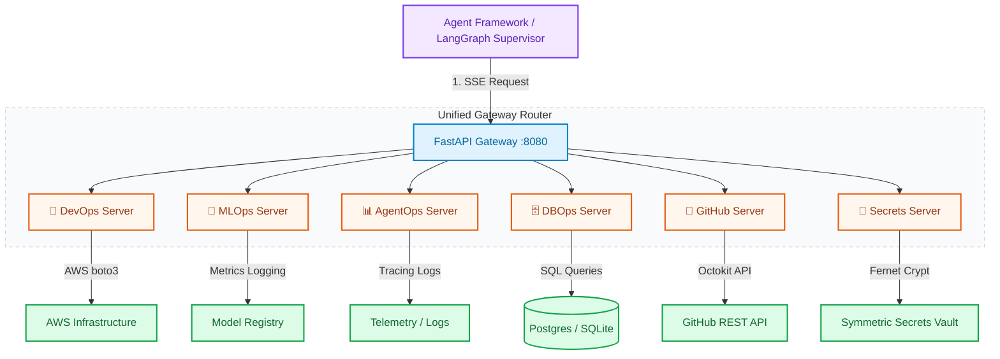

# 🛠️ Ops MCP Suite — Production Agent Platform Engineering Toolkit

<p align="center">
  
  
  
  
  
</p>

A production-grade collection of **6 Model Context Protocol (MCP) servers** that provide essential operational tooling for AI agent platforms. Architected as a modular micro-MCP system, each server runs independently via standard `stdio` or connects through a unified FastAPI gateway to expose serverless HTTP/SSE endpoints.

Whether your agent swarm needs to provision S3 buckets, trace LLM latency, run database schema migrations, fetch repository PRs, or encrypt session secrets, the **Ops MCP Suite** secures and coordinates these tasks at scale.

---

## 🎨 System Architecture

This suite bridges the gap between natural language agent planners and secure infrastructure services, utilizing a unified gateway proxy to filter and execute tools dynamically.



---

## 💡 Key Features & Core Components

### 1. 🔧 DevOps MCP (`devops_mcp.py`)
Cloud infrastructure provisioning and health checking. Runs least-privilege AWS policies and monitors service latency.
*   **Create S3 Buckets**: Real boto3 bucket generation with enforced versioning and tagging structures.
*   **STS Assume Role**: Generate temporary credentials for Amazon Bedrock and AWS models.
*   **Service Latency Probing**: Active health checks with microsecond latency reporting.

### 2. 🧠 MLOps MCP (`mlops_mcp.py`)
Model serving telemetry, vector database provisioning, and model registry actions.
*   **Model Comparison**: Side-by-side performance metrics comparison (cost, tokens, error rates).
*   **Model Promotion**: Shift versions between Staging, Production, and Archived.
*   **Vector DB Provisioning**: Simulated Pinecone-style index creation and metric checks.

### 3. 📊 AgentOps MCP (`agentops_mcp.py`)
LLM tracing logs, prompt template versioning, and evaluators.
*   **Trace Accumulator**: Log nested traces to disk and summarize token loads and task durations.
*   **Prompt Registry**: Store, version-track, and retrieve prompt templates.
*   **Evaluation Runner**: Standard scoring templates to run LLM-as-a-judge tests.

### 4. 🗄️ DBOps MCP (`dbops_mcp.py`)
Schema inspection, migration testing, and database sandboxing.
*   **SQL Sandboxing**: Execute read-only queries safely, with row limit constraints.
*   **Schema Inspector**: Query tables, indexes, and detailed column data types.
*   **Database Cloner**: Clone SQLite databases on the fly to test migrations without corrupting prod databases.

### 5. 🐙 GitHub MCP (`github_mcp.py`)
Repository synchronization, file access, and developer issue routing.
*   **Branch Search**: Search repositories, retrieve detailed file metadata, and read target directories.
*   **Issue Orchestrator**: Open, label, and assign issues dynamically.
*   **Pull Request Inspector**: Query open pull requests and check review statuses.

### 6. 🔐 Secrets MCP (`secrets_mcp.py`)
Symmetric encryption key-rotation and secure local vaulting.
*   **Fernet Encryption**: Enforces AES-128 encryption on stored credentials.
*   **Key Rotation**: Rotate master keys dynamically while preserving vault contents.
*   **API Key Generator**: Cryptographically secure entropy API key builder.

---

## 📋 Tool Reference Index

| Server | File Name | Available Tools | Real / Simulated |
| :--- | :--- | :--- | :--- |
| **DevOps** | `devops_mcp.py` | `provision_s3_bucket`, `generate_bedrock_credentials`, `manage_secrets`, `create_iam_policy`, `deploy_docker_container`, `check_service_health` | Real (boto3 / STS) & Simulated |
| **MLOps** | `mlops_mcp.py` | `provision_vector_db`, `trigger_fine_tuning`, `list_model_registry`, `promote_model`, `fetch_model_metrics`, `compare_models` | Telemetry & Simulated |
| **AgentOps** | `agentops_mcp.py` | `create_langsmith_project`, `run_eval_harness`, `log_agent_trace`, `get_trace_summary`, `create_prompt_template`, `list_prompt_versions` | Real File Logs & Telemetry |
| **DBOps** | `dbops_mcp.py` | `provision_database`, `apply_migrations`, `run_query`, `list_tables`, `clone_database`, `create_read_only_user`, `get_db_stats` | Real SQLite Actions & Schema |
| **GitHub** | `github_mcp.py` | `list_repos`, `get_repo_info`, `list_pull_requests`, `create_issue`, `search_code`, `get_file_contents` | Real GitHub API & Fallback |
| **Secrets** | `secrets_mcp.py` | `store_secret`, `get_secret`, `list_secrets`, `delete_secret`, `rotate_secret`, `generate_api_key` | Real Fernet Symmetric Crypt |

---

## 🚀 Quick Start Guide

### 1. Local Stdio Standalone Mode (For Claude Desktop / Clients)
To run a server directly via stdin/stdout:
```bash
# Clone the repository
git clone https://github.com/akmalkhaniub/ops-mcp-suite.git
cd ops-mcp-suite

# Install dependencies
pip install -r requirements.txt

# Run any server standalone
python devops_mcp.py
```

### 2. Unified Gateway Mode (FastAPI SSE Router)
To run all 6 servers exposed through a unified HTTP/SSE proxy:
```bash
python gateway.py
# Gateway starts up at http://localhost:8080
```

#### Test an API Call
You can trigger a tool calculation using a simple HTTP request:
```bash
curl -X POST http://localhost:8080/secrets/call/generate_api_key \
     -H "Content-Type: application/json" \
     -d '{"length": 32}'
```

---

## 🐳 Docker Deployment

To build and run the containerized gateway locally:
```bash
# Build the container
docker build -t ops-mcp-gateway .

# Run the container
docker run -p 8080:8080 --env-file .env ops-mcp-gateway
```

### Deploy to Google Cloud Run
Expose the gateway securely to serverless swarms:
```bash
# Push container to Google Artifact Registry
gcloud builds submit --tag us-central1-docker.pkg.dev/YOUR_PROJECT_ID/YOUR_REPO/ops-mcp-gateway:latest

# Deploy to Cloud Run
gcloud run deploy ops-mcp-gateway \
  --image us-central1-docker.pkg.dev/YOUR_PROJECT_ID/YOUR_REPO/ops-mcp-gateway:latest \
  --port 8080 \
  --region us-central1 \
  --allow-unauthenticated
```

---

## ⚙️ Environment Configurations

Create a `.env` file in the root directory to activate integrations:
```env
# GitHub integration
GITHUB_TOKEN=ghp_yourPersonalAccessTokenHere

# Secrets encryption
VAULT_MASTER_KEY=yourFernetKeyHere (generate via secrets_mcp.py rotate_secret)

# AWS Credentials
AWS_ACCESS_KEY_ID=AKIA...
AWS_SECRET_ACCESS_KEY=...
AWS_DEFAULT_REGION=us-east-1

# Gateway Configuration
PORT=8080
```

---

## 📁 Project Structure

```text
ops-mcp-suite/
├── gateway.py          # FastAPI serverless gateway (SSE proxy)
├── devops_mcp.py       # DevOps server (6 tools)
├── mlops_mcp.py        # MLOps server (6 tools)
├── agentops_mcp.py     # AgentOps server (6 tools)
├── dbops_mcp.py        # DBOps server (7 tools)
├── github_mcp.py       # GitHub server (6 tools)
├── secrets_mcp.py      # Secrets Crypt server (6 tools)
├── test_all_servers.py # Suite validation script
├── Dockerfile          # Multi-stage image build
├── .env.example        # Environment blueprint
├── requirements.txt    # Library configurations
└── README.md           # This documentation
```

---

## 🏁 License & Contact

Distributed under the MIT License. See `LICENSE` for more information.

*Project Lead: Akmal Khan*
*Email: akmal.shahbaz@iub.edu.pk*  
*Repository Link: [https://github.com/akmalkhaniub/ops-mcp-suite](https://github.com/akmalkhaniub/ops-mcp-suite)*
